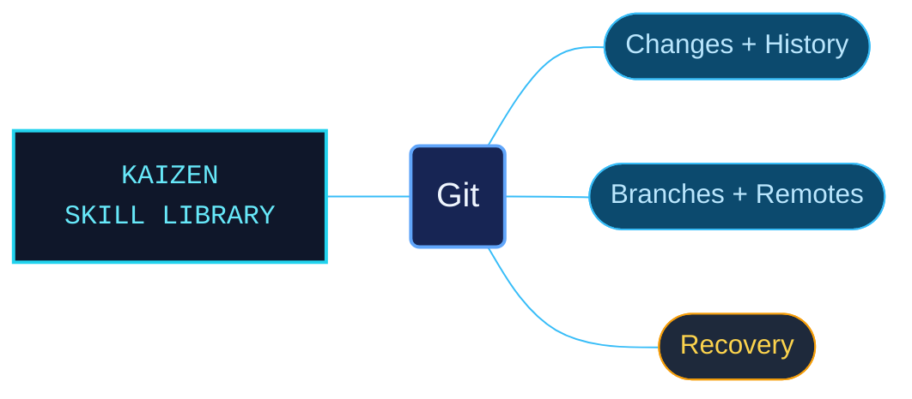

# Git

Git reference guidance for inspecting changes, managing branches and remotes, and recovering repository history. Task routes connect everyday commands with the revision syntax, configuration and recovery details needed to use them deliberately.

Use for Git commands, options, configuration, refspecs and revision ranges; staging, commits, branches, merges, rebase, cherry-pick, revert, reset, stash and tags; history, diffs, blame, bisect and grep; remotes, fetch/pull/push and tracking; hooks, attributes, submodules, worktrees and sparse checkout; reflog/fsck recovery, gc and plumbing. Also use for .gitignore, .gitattributes, .git/config, .git/hooks, Git errors and conflict markers, or choosing a version-control command without an explicit Git mention.

## What this skill helps with

| Task | Useful reference material |
| --- | --- |
| [Review and record changes](references/snapshotting.md) | Choose what to stage and commit, then inspect differences and history. |
| [Integrate branches](references/branching-and-merging.md) | Work through branch and merge operations with their effects on repository history. |
| [Work with remotes](references/remotes-and-sync.md) | Understand fetch, pull, push and tracking before synchronizing repositories. |
| [Recover and maintain a repository](references/recovery-and-maintenance.md) | Find reflog, integrity and maintenance guidance when repository state needs investigation. |

## The work behind the references

The command material is organized by the job being performed, with descriptive filenames and linked revision, configuration and plumbing references. Command examples and shell-quoting guidance keep arguments and execution context visible alongside the prose.

## Start here

Start with [SKILL.md](SKILL.md) and follow its context routes.

Start with the [command safety and shell-quoting guidance](references/command-safety-and-shell-quoting.md) when adapting examples. Inspect the current repository state before applying commands that rewrite history or remove files.

## Sources and license

Skill reference documentation is interpreted content for use in open source projects. Check against [official documentation sources](https://git-scm.com/docs) when dealing with defects or issues that may come up from interpreting this skill's references.

Licensed under **AGPL-3.0**; see [LICENSE](LICENSE). Part of the [Agent Kaizen](https://github.com/LevyBytes/agent-kaizen) skill library.
